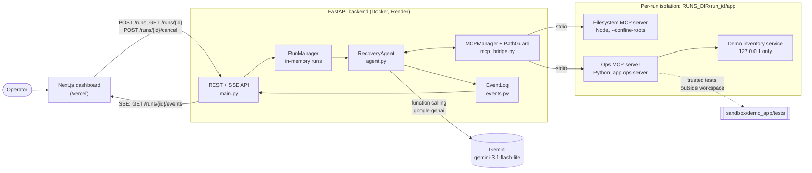
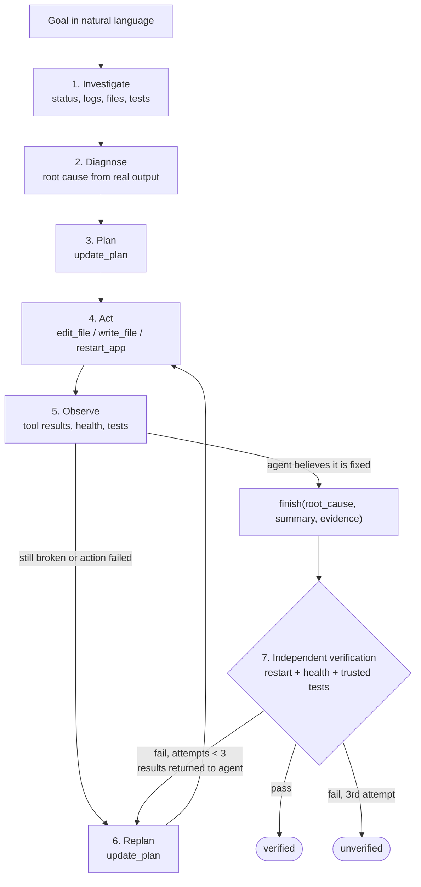
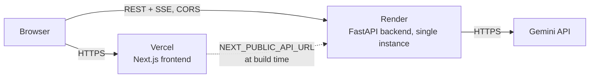

<div align="center">

# RescueOps

### Diagnose. Decide. Act. Verify.

**An autonomous AI DevOps recovery agent.** Describe an incident in plain language. RescueOps
investigates an isolated copy of the service, finds the root cause, repairs it through controlled MCP
tools and only reports success after the backend has independently verified the recovery.

[](https://rescue-ops-kappa.vercel.app)
[](https://rescueops-333d.onrender.com/health)
[](https://rescueops-333d.onrender.com/docs)


Built by **Team CrashOverride** for the Google AI Agentathon.

</div>

---

## Table of Contents

- [Why RescueOps](#why-rescueops)
- [Key Features](#key-features)
- [Live Deployment](#live-deployment)
- [Architecture](#architecture)
- [The Autonomous Recovery Lifecycle](#the-autonomous-recovery-lifecycle)
- [Agent Design and Gemini Integration](#agent-design-and-gemini-integration)
- [MCP Tools and the Controlled Execution Model](#mcp-tools-and-the-controlled-execution-model)
- [Sandbox, Isolation and Safety Boundaries](#sandbox-isolation-and-safety-boundaries)
- [Demo Scenarios](#demo-scenarios)
- [Screenshots](#screenshots)
- [Tech Stack](#tech-stack)
- [Getting Started](#getting-started)
- [Running with Docker](#running-with-docker)
- [Testing](#testing)
- [API Reference](#api-reference)
- [Deployment](#deployment)
- [Known Limitations and Security Considerations](#known-limitations-and-security-considerations)
- [Roadmap](#roadmap)
- [Project Structure](#project-structure)
- [Team](#team)
- [Contributing](#contributing)
- [License](#license)

---

## Why RescueOps

### The problem

Most automated remediation is a runbook in code: *if this alert fires, run that script*. That
approach is brittle:

- **It only handles failures someone predicted.** A new failure mode needs a new rule, and an
  incident that resembles a known one can trigger the wrong fix.
- **It acts without understanding.** A script restarts a crashing service whatever the cause, so a
  bad config or a code regression crashes it again straight away.
- **It trusts itself.** A script that exits 0 counts as success, whether or not the service works.

### The solution

RescueOps replaces the fixed decision tree with an agent that reasons from evidence:

- The agent gets **only the operator's goal**, for example *"Investigate why my application is broken and
  recover it."* It is never told which scenario was injected.
- Gemini decides **every tool call** based on real observations: status, logs, config, source
  and test output. The backend contains no scenario-specific fixes.
- When an action fails or a check stays red, the agent **reads the error and replans**.
- Success is decided by the backend, not the model. When the agent calls `finish`, the backend
  **independently restarts the service, health-checks it and runs a trusted test suite** before it
  marks the run `verified`.

RescueOps is not a scripted chatbot and does not follow a predefined sequence of fixes.

---

## Key Features

| | |
|---|---|
| **Goal-driven autonomy** | Natural-language goal in; Gemini chooses tools turn by turn with manual function calling. |
| **Real MCP integration** | Two MCP servers per run over stdio: the official `@modelcontextprotocol/server-filesystem` and a custom ops server. Tools are discovered at runtime and converted to Gemini function declarations. |
| **Living plan** | The agent keeps an explicit plan of up to 8 steps through an `update_plan` control tool and revises it as evidence comes in. The plan streams to the UI. |
| **Independent verification** | `finish` triggers restart, an HTTP health check (`/health` and `/api/items`) and a trusted unit-test suite. A failed check returns control to the agent, with up to 3 verification attempts. |
| **Isolated per-run workspaces** | Each run gets a fresh copy of the demo service with one fault injected. The workspace is deleted when the run ends. |
| **Layered safety** | No shell tool, a tool allowlist, a two-layer path jail, read-only `tests/` and `logs/`, scrubbed child environments, rlimits, timeouts and step/tool/time budgets. |
| **Live observability** | Server-Sent Events stream of plan updates, agent status, tool calls, results and verification. Supports `Last-Event-ID` replay and heartbeats. |
| **Blind Challenge** | A scenario whose root cause is undisclosed even in its name and description. It shows the agent diagnosing from evidence rather than recognising a label. |

---

## Live Deployment

| Component | URL |
|---|---|
| Frontend (Vercel) | **https://rescue-ops-kappa.vercel.app** |
| Backend health (Render) | https://rescueops-333d.onrender.com/health |
| Interactive API docs (Swagger UI) | https://rescueops-333d.onrender.com/docs |

`GET /health` reports only whether a Gemini key is configured, never the key itself:

```json
{"status": "ok", "version": "0.1.0", "gemini_configured": true, "model": "gemini-3.1-flash-lite"}
```

---

## Architecture



**What happens in a run** (`backend/app/runs.py`):

1. `POST /runs` creates a run (`queued`) and starts an asyncio task. Up to `MAX_CONCURRENT_RUNS`
   can be active, and the request gets `429` beyond that.
2. The task copies the clean template `sandbox/demo_app` into `RUNS_DIR/<run_id>/app` and applies
   the selected fault.
3. Both MCP servers start for that workspace, and their tools are discovered and exposed to Gemini.
4. The agent loop runs and emits events to the run's `EventLog`, which the SSE endpoint replays
   and streams.
5. On completion, cancellation or error, the app is stopped, MCP servers shut down, stray
   processes inside the workspace are killed and the workspace is deleted.

Run status: `queued → running → verified | unverified | failed | cancelled`.

---

## The Autonomous Recovery Lifecycle

The model drives each stage by choosing tools. The backend executes the calls, enforces limits and
owns the final verdict.



| Stage | How it happens |
|---|---|
| **Investigate** | Read-only calls such as `get_app_status`, `start_app`, `read_logs`, `list_directory`, `read_text_file` and `run_tests`. The system prompt says to gather evidence before changing anything. |
| **Diagnose** | Gemini reasons over actual tool output, such as tracebacks, config values and test failures. The diagnosis is reported as `root_cause` and `evidence` on `finish`. |
| **Plan** | `update_plan` sends the full plan each time, with steps marked `pending`, `in_progress`, `done`, `failed` or `skipped`. |
| **Act** | The agent makes a minimal repair through allowlisted write tools (`edit_file`, `write_file`, `copy_file`, `create_directory`), then `restart_app`. |
| **Observe** | Every tool result, including errors, is returned verbatim to the model as a size-bounded observation. |
| **Replan** | Failed actions, red checks and failed verification are all returned as observations, and the agent revises its plan. |
| **Independently Verify** | The backend, not the model, runs `restart_app`, `run_health_check` and `run_tests` against the trusted suite. Only all three passing produces `verified`. |

---

## Agent Design and Gemini Integration

The agent (`backend/app/agent.py`) uses the **`google-genai` SDK** with **manual function calling**.
Automatic function calling is disabled, so the backend executes, bounds and logs every call.

- **Model:** `GEMINI_MODEL`, default `gemini-3.1-flash-lite`. Temperature is `0.2` and the
  function-calling mode is `AUTO`.
- **Tools offered to Gemini:** the allowlisted MCP tools discovered at runtime, plus two control
  tools:
  - `update_plan(steps[])`: create or revise the plan, max 8 steps.
  - `finish(status, root_cause, summary, evidence[])`: `status` is `recovered` or `failed`.
    `recovered` triggers independent verification.
- **Generic system prompt:** it contains no hints about any scenario. It tells the agent to
  gather evidence first, make the smallest correct repair, treat `tests/` and `logs/` as read-only
  and never invent tool results.
- **Conversation handling:** model turns are appended verbatim, which preserves thought signatures.
  Thought parts are never emitted to the UI; only short non-thought status text is shown.
- **Resilience:** transient Gemini errors (5xx, 429) are retried with backoff inside the run
  deadline, and SDK-level retries are disabled. A turn without a tool call gets a nudge, and the
  run fails after 2 idle turns.

**Budgets and limits** (constants in `agent.py`; configurable ones via environment):

| Limit | Value |
|---|---|
| Model turns per run | `MAX_AGENT_STEPS` (default 20) |
| MCP tool calls per run | `MAX_TOOL_CALLS` (default 40) |
| Wall-clock run timeout | `RUN_TIMEOUT_S` (default 300 s) |
| Tool calls per model turn | 6 |
| Verification attempts | 3 |
| Model call / tool call timeout | 90 s / 45 s |
| Observation size returned to the model | 6,000 chars |

**Outcomes:** `verified` (verification passed), `unverified` (the agent claimed recovery but
verification failed 3 times), `failed` (agent gave up, limits hit, API or setup error), and
`cancelled`.

---

## MCP Tools and the Controlled Execution Model

`backend/app/mcp_bridge.py` (`MCPManager`) starts **two stdio MCP servers per run** with the Python
`mcp` SDK. It discovers their tools with `list_tools`, converts their JSON Schemas into Gemini
`FunctionDeclaration`s and routes calls with timeouts and size limits. The agent uses
workspace-relative paths. The bridge rewrites them to absolute paths for the server and maps
absolute paths in results back, so host paths are not revealed.

### Filesystem server: official `@modelcontextprotocol/server-filesystem` 2.4.0

Started with `--confine-roots <workspace>`. Only this subset is exposed:

| Read | Write |
|---|---|
| `read_text_file`, `read_multiple_files`, `list_directory`, `directory_tree`, `search_files`, `get_file_info` | `write_file`, `edit_file`, `create_directory`, `copy_file` |

Deliberately **not** exposed: `move_file` (destructive), `read_media_file`, `read_file`
(deprecated alias), `append_file`, `list_directory_with_sizes`, and `list_allowed_directories`
(would reveal host paths).

### Ops server: custom `rescueops-ops` (`backend/app/ops/`)

One process per run, bound to exactly one workspace. **No tool accepts a path or a command.** Each
tool runs a fixed argv with a timeout and an output cap.

| Tool | Behaviour |
|---|---|
| `get_app_status` | `not_started`, `running` (pid, port, uptime) or `exited` (exit code) |
| `start_app` | Starts `app.py` on a free localhost port and returns the log tail if it crashes during startup |
| `stop_app` | Terminates the app process, then kills it if it does not stop |
| `restart_app` | Stop, then start |
| `read_logs` | Last N lines (1–200) of the app's stdout/stderr log |
| `run_health_check` | HTTP GET `/health` and `/api/items`; healthy only if both return 200 |
| `run_tests` | Runs the **trusted** unit-test suite against the workspace code |

---

## Sandbox, Isolation and Safety Boundaries

| Boundary | Implementation |
|---|---|
| **No shell** | The agent can only call allowlisted MCP tools. Ops tools run fixed argv only. |
| **Path jail (two layers)** | The filesystem server is confined to the workspace, and `PathGuard` re-validates every path argument. It rejects escapes via `..`, absolute paths outside the workspace, symlinks (resolved with `realpath`), NUL bytes and writes to the workspace root. |
| **Check integrity** | Writes to `tests/` and `logs/` are blocked. Verification also never runs the workspace's own `tests/`: it runs a fresh copy of the pristine template tests from outside the workspace, under `python -I -S` with the workspace appended last to `sys.path`. Workspace files therefore cannot shadow the runner or the standard library. |
| **Secret isolation** | MCP servers, the app and the tests get a minimal environment with no `GEMINI_API_KEY`. The tests assert this. |
| **Process limits** | 512 MB address space and 10 MB file size rlimits, a 30 s test timeout, truncated output and a localhost-only bind for the app. |
| **Process cleanup** | Children share the ops server's process group, so shutdown kills them all. After teardown, any process whose cwd is inside the workspace is also killed (Linux `/proc`). |
| **Ephemeral state** | Each workspace is created per run and deleted afterwards. The container runs as a non-root user with `tini` as PID 1. |
| **Bounded autonomy** | Step, tool-call, per-turn, per-call and total-time budgets, plus bounded observation sizes. |

> **Residual risk:** the agent can edit application code that the app and tests then execute.
> This is necessary for code repairs and is contained by the limits above, the scrubbed
> environment and the ephemeral container.

---

## Demo Scenarios

Each run copies the healthy demo service, a small stdlib-only Python inventory API with
`/health` and `/api/items`, and injects one fault (`backend/app/workspace.py`). The scenario
description is shown to the **human operator only**. The agent receives only the goal.

| Scenario ID | Name | Injected fault | Symptom the agent must trace |
|---|---|---|---|
| `bad-config` | Bad Configuration | `max_items` in `config.json` set to the string `"fifty"` | App refuses to start with a config type error |
| `code-bug` | Code Bug | `inventory.total_value` reads `item["quantity"]` instead of `item["qty"]` | `KeyError` on startup; tests fail |
| `missing-file` | Missing File | `data/items.json` renamed to `items.json.bak`, simulating a bad deploy | `FileNotFoundError` on startup |
| `blind-incident` | **Blind Challenge** | *Undisclosed: see below* | App crashes at startup |

### The Blind Challenge

The Blind Challenge tests diagnosis without any label to go on. Its ID and description ("Undisclosed fault (blind
challenge)") are chosen so they **do not reveal the root cause**. The injection is also designed to
leave no clues:

- It is a **targeted single-token text edit**, so the file's formatting is otherwise identical.
- The file's **original modification time is restored**, so `get_file_info` and timestamps do not
  point to the changed file.
- The failure appears in a different place from where the fault is. The crash happens in the code,
  but the code is correct.

<details>
<summary><strong>Spoiler: the actual root cause</strong></summary>

One inventory record in `data/items.json` stores its quantity as a string (`"qty": "3"` instead of
`3`). `total_value()` then fails with a `TypeError` when it multiplies `"3"` by a float. The agent
has to follow the traceback into `inventory.py`, see that the code is correct, and inspect the
data to find the one bad record among valid ones. Changing the code to tolerate the bad record is
not enough, because the trusted tests and the health check have to pass on a clean restart.

</details>

---

## Screenshots

> No screenshots are committed to the repository yet. To see the dashboard, open the
> [live demo](https://rescue-ops-kappa.vercel.app).

**To add screenshots:**

1. Create a `docs/screenshots/` directory.
2. Capture the launch screen, a run in progress (plan, execution log), and a verified outcome
   (ideally from the Blind Challenge).
3. Save them as, for example, `launch.png`, `run-live.png` and `verified.png`, then reference them here:

```markdown


```

---

## Tech Stack

| Layer | Technology |
|---|---|
| **AI model** | Google Gemini (`gemini-3.1-flash-lite`) via `google-genai` 3.6.1 |
| **Tool protocol** | Model Context Protocol: Python `mcp` 2.3.0 (client + ops server), `@modelcontextprotocol/server-filesystem` 2.4.0 |
| **Backend** | Python 3.12, FastAPI 0.165, Uvicorn, Pydantic, AnyIO, python-dotenv |
| **Streaming** | Server-Sent Events (FastAPI `StreamingResponse`; browser `EventSource`) |
| **Frontend** | Next.js 16 (App Router), React 19, TypeScript 5, Tailwind CSS 4 |
| **Testing** | pytest 9 + httpx (backend); Node's built-in `node --test` (frontend) |
| **Runtime / infra** | Docker (Python 3.12-slim + Node 24, `tini`, non-root), Render (backend), Vercel (frontend) |

---

## Getting Started

### Prerequisites

- **Python 3.12**
- **Node.js 24** recommended. The filesystem MCP server requires Node ≥ 24; Node 22 works locally
  with an engine warning. The frontend needs Node ≥ 20.9.
- **npm**
- A **Gemini API key** from [Google AI Studio](https://aistudio.google.com/)
- Linux or macOS. The post-run process sweep uses Linux `/proc` and does nothing on other systems.
- Optional: **Docker**

### 1. Clone

```bash
git clone https://github.com/Ehmad-7/RescueOps.git
cd RescueOps
```

### 2. Configure environment variables

`.env.example` at the repository root is the source of truth for backend configuration:

```bash
cp .env.example .env
# then edit .env and set GEMINI_API_KEY
```

The backend loads `backend/.env` and the repository-root `.env`. Real environment variables take
precedence over both.

| Variable | Required | Default | Description |
|---|---|---|---|
| `GEMINI_API_KEY` | **yes** | none | Gemini API key. Without it, `POST /runs` returns `503`. |
| `GEMINI_MODEL` | no | `gemini-3.1-flash-lite` | Gemini model ID |
| `ALLOWED_ORIGINS` | yes, when deployed | `http://localhost:3000` | Comma-separated exact CORS origins for the frontend |
| `RUNS_DIR` | no | `/tmp/rescueops/runs` | Where per-run workspaces are created; must be writable |
| `MAX_AGENT_STEPS` | no | `20` | Max model turns per run |
| `MAX_TOOL_CALLS` | no | `40` | Max MCP tool calls per run |
| `RUN_TIMEOUT_S` | no | `300` | Wall-clock limit per run, in seconds |
| `MAX_CONCURRENT_RUNS` | no | `2` | Active-run cap; `POST /runs` returns `429` beyond it |
| `PORT` | no | `8080` | Container listen port (Docker image only) |

The frontend reads a single variable from **`frontend/.env.local`**. Next.js does not read the
root `.env`.

| Variable | Required | Description |
|---|---|---|
| `NEXT_PUBLIC_API_URL` | **yes** | Backend base URL without a trailing slash, e.g. `http://localhost:8000` |

> `NEXT_PUBLIC_*` values are inlined into the browser bundle at build time. Never put secrets in
> them. The Gemini key stays on the backend only.

### 3. Backend

```bash
cd backend
python3 -m venv .venv
.venv/bin/pip install -r requirements-dev.txt   # or requirements.txt for runtime only
npm install                                      # installs the filesystem MCP server
.venv/bin/uvicorn app.main:app --reload --port 8000
```

Check it:

```bash
curl http://localhost:8000/health
```

### 4. Frontend

In a second terminal:

```bash
cd frontend
cp .env.example .env.local     # NEXT_PUBLIC_API_URL=http://localhost:8000
npm install
npm run dev                    # http://localhost:3000
```

Open http://localhost:3000, pick a scenario and launch a recovery run.

| Frontend script | Purpose |
|---|---|
| `npm run dev` | Development server |
| `npm run build` | Production build, including type checking |
| `npm start` | Serve the production build |
| `npm run lint` | ESLint |
| `npm test` | Unit tests for `src/lib` |

---

## Running with Docker

The `Dockerfile` at the repository root builds the **backend** image: Python 3.12-slim, the Node 24
runtime for the filesystem MCP server, the FastAPI app and `sandbox/demo_app`. It runs as a
non-root user under `tini` and listens on `$PORT` (default `8080`). No secrets are copied into the
image.

Build from the **repository root**, because the build needs both `backend/` and `sandbox/`:

```bash
docker build -t rescueops-backend .
```

Run it. `-e GEMINI_API_KEY` without a value passes the key through from your shell, so it does not
appear in the command:

```bash
export GEMINI_API_KEY=...        # or load it from your secret manager
docker run --rm -p 8080:8080 \
  -e GEMINI_API_KEY \
  -e ALLOWED_ORIGINS=http://localhost:3000 \
  rescueops-backend

curl http://localhost:8080/health
```

Point the frontend at the container with `NEXT_PUBLIC_API_URL=http://localhost:8080` in
`frontend/.env.local`. The frontend has no Dockerfile; run it with `npm` as shown above or deploy
it to Vercel.

---

## Testing

**Backend** (90 tests). Covers the agent loop with a scripted model over real MCP servers, the API
and SSE, the MCP bridge and path jail, ops tools, workspaces and secret isolation. Gemini is not
called, but the tests need `npm install` in `backend/` because they start the real filesystem MCP
server.

```bash
cd backend
.venv/bin/pytest            # add -q for compact output
```

**Frontend** (35 tests). Covers the API client, SSE stream handling, the event reducer and phase
derivation.

```bash
cd frontend
npm test
npm run lint
```

---

## API Reference

FastAPI serves interactive documentation at **`/docs`** (Swagger UI) and the schema at
`/openapi.json`. Live: https://rescueops-333d.onrender.com/docs

| Method | Path | Description | Notable responses |
|---|---|---|---|
| `GET` | `/health` | Service status, version, model, and whether Gemini is configured | `200` |
| `GET` | `/scenarios` | List of `{id, description}` fault scenarios | `200` |
| `POST` | `/runs` | Start a run. Body: `{"goal": "...", "scenario": "<id>"}`. `goal` is optional, 3–500 chars | `202` run summary + `events_url`; `422` unknown scenario; `429` too many active runs; `503` Gemini not configured |
| `GET` | `/runs/{id}` | Run summary: status, timestamps, result, plan | `200`; `404` |
| `GET` | `/runs/{id}/events` | SSE event stream. Replays from `Last-Event-ID` header or `?after=<seq>`, sends `: keep-alive` every 15 s and closes after the terminal event | `200` `text/event-stream`; `404` |
| `POST` | `/runs/{id}/cancel` | Cancel an active run | `202`; `404`; `409` if already finished |

**Example:**

```bash
curl -X POST http://localhost:8000/runs \
  -H 'Content-Type: application/json' \
  -d '{"goal": "Investigate why my application is broken and recover it.", "scenario": "blind-incident"}'

curl -N http://localhost:8000/runs/<run_id>/events
```

**SSE events** use the format `id: <seq>` / `event: <type>` / `data: <json>`. Event types:
`run_started`, `plan_updated`, `agent_status`, `tool_started`, `tool_completed`, `tool_failed`,
`verification_started`, `verification_completed`, `run_completed`, `run_failed`,
`run_cancelled`.

---

## Deployment



**Frontend on Vercel**
- Root directory: `frontend/`.
- Set `NEXT_PUBLIC_API_URL` to the backend URL **before building**, and rebuild after any change.

**Backend on Render**
- The container is defined by the root `Dockerfile` and honours the `PORT` variable the platform
  sets.
- Set `GEMINI_API_KEY` as a secret and `ALLOWED_ORIGINS` to the exact frontend origin, for example
  `https://rescue-ops-kappa.vercel.app`.
- The Render service is configured in the Render dashboard. The repository contains no
  `render.yaml`.
- **Use a single instance.** Runs and their event logs are held in memory, and the agent keeps
  working after `POST /runs` returns. Status and SSE requests must reach the instance that owns
  the run.

`DEPLOY.md` contains equivalent instructions for **Google Cloud Run** (`--max-instances 1`,
`--no-cpu-throttling`, `--timeout 900`, Secret Manager for the key). The `Dockerfile` header
comments refer to Cloud Run as well, but the image is not platform-specific.

---

## Known Limitations and Security Considerations

- **In-memory, single-instance state.** There is no database. Runs are lost on restart, redeploy or
  scale-to-zero, and horizontal scaling is not supported. At most 100 runs are kept.
- **No authentication or rate limiting.** Anyone who can reach the backend can start runs.
  `MAX_CONCURRENT_RUNS` is the only cap on Gemini usage. Do not expose a deployment with a costly
  key without adding protection in front of it.
- **One target service.** The agent operates on the bundled demo inventory service and its four
  fault scenarios. It is not yet connected to real infrastructure such as containers, Kubernetes or
  cloud APIs.
- **No human approval gate.** Write actions inside the sandbox run without interactive
  confirmation. Safety relies on the allowlist, path jail, protected directories and resource
  limits.
- **The agent can run the code it edits.** Repairs to application code are executed by the app and
  the tests. This is contained by rlimits, a scrubbed environment, a localhost-only bind and an
  ephemeral container, but it is not a VM-level sandbox.
- **Linux-specific cleanup.** The workspace process sweep uses `/proc`, and `resource` rlimits
  are POSIX-only.
- **Model variance.** Behaviour depends on the Gemini model. Development runs used
  `gemini-3.1-flash-lite`.
- **Cold starts.** If the hosting plan spins the backend down when idle, the first request can be
  slow and any in-memory runs are gone.

---

## Roadmap

> The items below are **planned and not implemented**.

- [ ] Interactive human-in-the-loop approval for sensitive actions, from the dashboard
- [ ] Multi-fault scenarios where the first fix only partly recovers the service, to exercise
      replanning further
- [ ] Persistent run history, so runs survive restarts and multiple instances can be used
- [ ] Authentication and per-user rate limiting for the public API
- [ ] Evaluation across larger Gemini models
- [ ] Adapters for real targets, such as containers and cloud services, behind the same
      allowlisted MCP tools

---

## Project Structure

```text
RescueOps/
├── backend/
│   ├── app/
│   │   ├── main.py          # FastAPI app: REST + SSE endpoints, CORS
│   │   ├── config.py        # Settings from environment / .env
│   │   ├── runs.py          # RunManager: run lifecycle, concurrency, cleanup
│   │   ├── agent.py         # RecoveryAgent: Gemini loop, control tools, verification
│   │   ├── mcp_bridge.py    # MCP client manager, schema conversion, PathGuard
│   │   ├── events.py        # Append-only, replayable event log
│   │   ├── workspace.py     # Per-run workspaces and fault scenarios
│   │   └── ops/             # Custom ops MCP server + controller
│   ├── tests/               # pytest suite
│   ├── package.json         # Node MCP filesystem server dependency
│   └── requirements*.txt
├── frontend/                # Next.js dashboard (see frontend/README.md)
│   └── src/{app,components,lib}
├── sandbox/demo_app/        # Healthy demo service template + trusted tests
├── Dockerfile               # Backend container image
├── DEPLOY.md                # Container / Cloud Run deployment notes
└── .env.example             # Backend configuration template
```

---

## Team

**CrashOverride** built RescueOps for the Google AI Agentathon.

---

## Contributing

Contributions are welcome.

1. Fork the repository and create a feature branch from `main`.
2. Set up the backend and frontend as described in [Getting Started](#getting-started).
3. Keep the agent **scenario-agnostic**: do not add scenario-specific logic or hints to the
   prompt, tools or verification.
4. Keep the safety model intact. New tools must take no free-form commands, respect the path jail
   and never expose secrets to child processes.
5. Run `pytest` in `backend/` and `npm test` and `npm run lint` in `frontend/` before you open a pull request.
6. Never commit `.env` files or API keys.

---

## License

This repository currently has **no license**. Until one is added, all rights are reserved by the
authors. Contact the team before you reuse the code.
